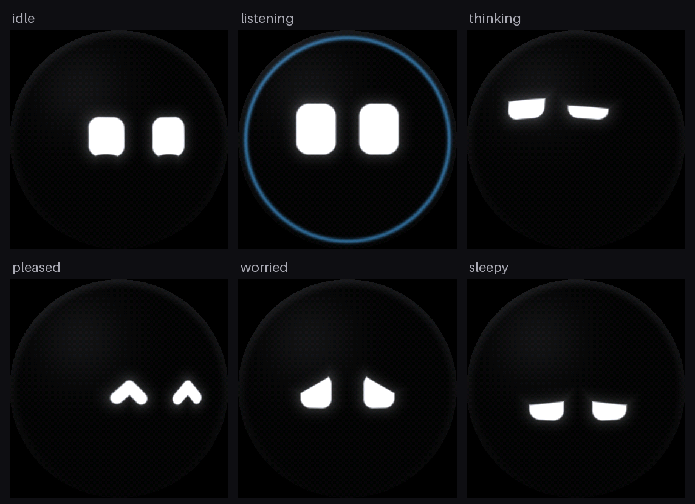
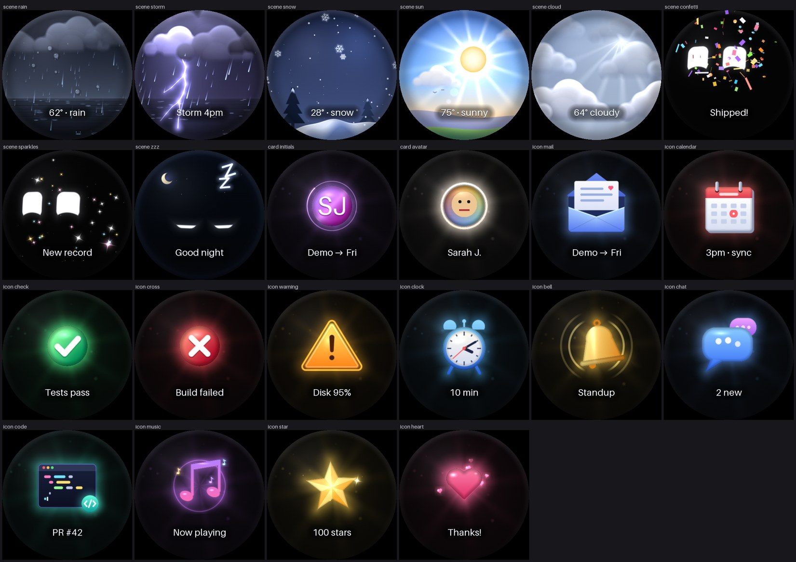
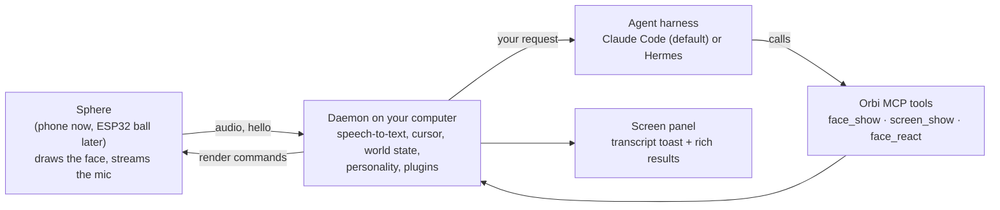

# Orbi

**A creature on your desk that you talk to, that does work for you, and that tells you when it's done.**

Orbi is a small, open-source desk companion for developers. It's a glowing orb, loosely inspired by the Las Vegas Sphere, whose whole surface is a display. Most of the time it's a pair of eyes with a personality: they follow your cursor, blink, glance around, get sleepy late at night and perk up when you come back. Hold a key and talk to it, and Orbi hands your request to an AI agent. The answer shows up on its face if it's glanceable, or in a panel on your screen if it needs words.



> **Status:** the software works end to end today, with your phone standing in as the sphere. The dedicated hardware (a round screen inside a 60 mm glass ball) is designed and on the way. See the [roadmap](#roadmap).

---

## What it's like

| You say | Orbi does |
| --- | --- |
| "What's the weather?" | Listens, nods, thinks, then the whole orb turns into a rain scene labelled `62° · rain`. Nothing opens on your screen. |
| "What was Sarah's email about?" | Shows Sarah's initials and `Demo → Fri`, then glances at your monitor as a panel opens with the full summary and an **Open in Gmail** button. |
| "Write me a regex for emails." | Thinks, glances at your screen, and the code appears in the panel. The face just shows a small "done" card. |

Orbi never talks back. It communicates entirely with its face:

| Meaning | What you see |
| --- | --- |
| I'm listening | Eyes widen, and a soft blue ring lights up around the rim (the mic is only on while the ring is) |
| I heard you | A quick blink |
| I didn't catch that | A confused, tilted look |
| Working on it | Thinking, then a busy look with side glances |
| Check your screen | A deliberate glance toward your monitor as the panel opens |
| Done / failed | A happy squint, or a worried look |
| I need you | An expectant look, held until you respond |

When it has something to show, the face briefly becomes a tiny screen, then goes back to being a creature. Weather fills the whole orb. Other content appears as small animated illustrations: an envelope that pops open, a bell that rings, a heart that beats.



---

## The hardware (final version)

The finished Orbi is a 60 mm glowing ball on a small ring stand that sits next to your keyboard.

| Part | What it is |
| --- | --- |
| Brain and screen | [Waveshare ESP32-S3-LCD-1.85](https://www.waveshare.com/esp32-s3-touch-lcd-1.85.htm?sku=28511): ESP32-S3 with a 1.85" round 360×360 ST77916 LCD and an onboard microphone, 16 MB flash and 8 MB PSRAM, on one board (the non-touch version, about $26) |
| Glass | A solid clear acrylic dome, 60 mm across, glued flat onto the bowl. It works as a lens: the screen looks about 1.5× bigger and fills the top half of the ball |
| Body | A black 3D-printed bowl that holds the board, with the screen flush with the rim |
| Stand | A small 3D-printed ring that the ball sits in, tilted toward you |
| Cable | USB-C for power and data, through a window in the side of the bowl |

There's no speaker (Orbi doesn't talk, so the board's speaker header stays empty) and no touch input (talking is a hold-to-talk key on your computer).

**Build outline**
1. Print `hardware/bowl.stl` and `hardware/ring.stl` in black (regenerate them with `python hardware/shell.py`, which needs CadQuery).
2. Drop the board into the bowl's pocket. It rests on three posts under its M2 standoffs, and a 1.5 mm hole lets sound reach the mic.
3. Glue the acrylic dome onto the rim.
4. Flash the firmware and plug in USB-C. Orbi pairs with the daemon on your computer over USB serial (Wi-Fi is optional).

The board outline and part positions in the CAD come from Waveshare's own 3D model of the board, so the fit is checked against the real thing. A full build guide and parts list with costs will come with the first prototype.

**Why it carries over from the phone:** the face isn't drawn by the phone app. It's portable C (`firmware/`) that the phone runs as WebAssembly, and the ESP32 will run as native code. The phone and the ball render exactly the same pixels from the same commands. Moving to hardware means writing new "glue" around that code (LCD driver, I2S mic, USB serial), not rewriting Orbi.

### Until then: your phone is the sphere

Prop a phone on your desk and it becomes Orbi: a glowing circle on a black screen, with its mic doing the listening. Scan a QR code shown by the daemon, accept the certificate warning once (it's your own computer), tap once to allow the mic, and leave it on a charger.

---

## How it works



- **The sphere is a thin client.** It only captures audio and draws what it's told. It holds no credentials and talks only to your own daemon.
- **The daemon is the brain.** It runs speech-to-text locally, tracks the cursor, holds the world state, hosts plugins, launches agents and owns the screen panel.
- **One face at a time.** Everything that happens becomes an event, and the face shows the highest-priority layer: *conversation > content > needs you > news > busy > idle*.
- **The agent decides where output goes** by calling Orbi's MCP tools. The daemon checks every face call, and anything that won't fit (unknown names, labels over 12 characters) goes to the screen instead. The face never shows truncated or garbled text.
- **Any MCP-capable agent can drive Orbi.** Claude Code is the default and runs on your own Claude login. Each run gets only web search, web fetch and Orbi's tools, and never a shell, because you can't approve risky actions by voice.

---

## Getting started (today, with a phone)

You'll need a Mac (cursor tracking and the hold-to-talk key are macOS-only for now), Python 3.10+, [Emscripten](https://emscripten.org) to build the face, and [Claude Code](https://claude.com/claude-code) logged in.

```sh
git clone https://github.com/Isha1218/orbi.git && cd orbi
brew install emscripten
python3 -m venv .venv && .venv/bin/pip install -e ".[test]"
phone/build.sh          # compile the face to WebAssembly
.venv/bin/orbi run      # prints a QR code; scan it with your phone
```

- **Talk:** hold **Right Option**, speak, let go. Your terminal needs **Input Monitoring** and **Accessibility** in System Settings → Privacy & Security.
- **Try it without a phone:** open `https://localhost:8765` in a browser.
- **Use Hermes instead of Claude Code:** `orbi run --harness hermes`.
- **Run the tests:** `.venv/bin/pytest tests`
- **Render face frames to PNG:** `firmware/tools/snap.sh <script> <out_dir>`

---

## Extending Orbi

A plugin is one Python file in `~/.orbi/plugins/`. It can give the agent new tools, react to events, put things on the face or screen, and add idle behaviors.

```python
from orbi.plugins import define_plugin

def setup(ctx):
    ctx.tools.register("get_weather", get_weather)               # a tool the agent can call
    ctx.on("agent.done", lambda e: ctx.face.react("pleased"))    # react to events
    ctx.emit({"type": "plugin.weather.alert", "layer": "news", "scene": "storm"})

plugin = define_plugin(name="weather", setup=setup)
```

Orbi ships with `weather` (Open-Meteo, no API key) and `email` (sender card plus summary panel) as examples. See [docs/plugins.md](docs/plugins.md). Plugins run with the daemon's full permissions, so only install ones you trust.

The device protocol (newline-delimited JSON plus binary frames for audio and images) is documented in [`firmware/protocol.h`](firmware/protocol.h). Anything that speaks it can be an Orbi.

---

## Privacy

- **Push-to-talk only.** Audio leaves the phone only while you hold the key, and the blue ring is always on while it's listening.
- **Speech-to-text runs on your computer** (faster-whisper). No audio is stored, ever.
- **No credentials on the device.** It only talks to your paired daemon on your own network.
- **The agent can't run commands or edit files.** Sensitive actions will need explicit approval on screen, never by voice alone.

---

## Roadmap

- [x] **Phase 1: phone sphere.** Daemon, phone app with QR pairing, cursor tracking, idle personality, push-to-talk, transcript toast, screen panel.
- [x] **Phase 2: agents.** MCP display tools, face validation with screen fallback, priority layers, Hermes adapter.
- [x] **Phase 3: plugin API.** Public plugin API, built-in scene and icon library, weather and email plugins.
- [x] **Claude Code harness**, now the default.
- [ ] **Phase 4: dedicated hardware.** ESP32-S3 glue for the LCD, mic and USB serial; first printed prototype; open hardware files and build guide. The richer scenes need optimizing to run smoothly on the ESP32.
- [ ] **Phase 5: community.** Adapters for other harnesses, a wake word, more scenes, enclosure variants, Windows and Linux support.

---

## Repository layout

```
firmware/   the face: portable C renderer (eyes, scenes, cards, font) + protocol parser
phone/      phone app: runs the firmware as WebAssembly, streams the mic
daemon/     Python daemon: server, world state, voice, panel, MCP tools, harnesses, plugins
hardware/   CadQuery script and printable STL/STEP files for the ball and stand
docs/       plugin guide and images
tests/      pytest suite
```

## License

Not chosen yet.
